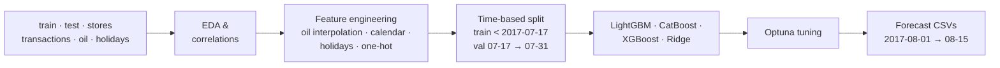

# Retail Sales Forecasting

Daily sales forecasts for every store × product family of Corporación Favorita, an Ecuadorian grocery chain, using the Kaggle [*Store Sales – Time Series Forecasting*](https://www.kaggle.com/competitions/store-sales-time-series-forecasting) data. The pipeline runs from exploratory analysis and feature engineering through a leakage-free validation split, three gradient-boosting models with Optuna tuning, and a linear baseline.

## Pipeline



## Highlights

- **EDA**: store-day aggregation, Spearman correlation between sales and transactions, an OLS fit, and monthly and day-of-week transaction trends.
- **Oil prices**: resampled to daily frequency, zeros treated as missing, linearly interpolated, then joined in. Correlations with oil are computed per product family.
- **Features**: calendar (year, month, day of week, weekend, quarter, day of year), holiday and event flags, promotions, store metadata, and a custom one-hot encoder.
- **Validation**: a contiguous hold-out window (2017-07-17 → 2017-07-31), never shuffled, so no future data leaks into training.
- **Models**: LightGBM, CatBoost, XGBoost, and a Ridge regression baseline. Each boosted model is tuned with Optuna.
- **Memory-conscious training**: dtype downcasting, persisted data splits for crash recovery, and explicit garbage collection on a small VM.

## Results

Validation RMSLE (lower is better):

| Model | Validation RMSLE |
| --- | ---: |
| **XGBoost** | **0.4841** |
| LightGBM | 0.4933 |
| CatBoost | 0.5274 |
| Ridge regression (baseline) | 0.9884 |

The tree ensembles roughly halve the linear baseline's error. Tuned hyperparameters are in [`outputs/`](outputs).

## Tech stack

Python · pandas · NumPy · statsmodels · scikit-learn · LightGBM · CatBoost · XGBoost · Optuna · matplotlib · seaborn

## Project structure

```text
Retail-Sales-Forecasting/
├── sales_forecasting.ipynb     # EDA → features → models → tuning
├── forecast_utils.py           # data loading, preprocessing, RMSLE, CSV export
├── outputs/                    # tuned hyperparameters (best_params_*.json)
└── requirements.txt
```

## Running locally

```bash
pip install -r requirements.txt

# Download the competition data (requires a Kaggle account + API token)
kaggle competitions download -c store-sales-time-series-forecasting
mkdir -p data/store-sales-time-series-forecasting
unzip store-sales-time-series-forecasting.zip -d data/store-sales-time-series-forecasting

jupyter lab sales_forecasting.ipynb
```

If the data lives somewhere else, set `DATA_DIR`. Generated forecasts go to `outputs/`, or to `OUTPUT_DIR` if you set it.

---

*Date finished: April 20, 2026*
